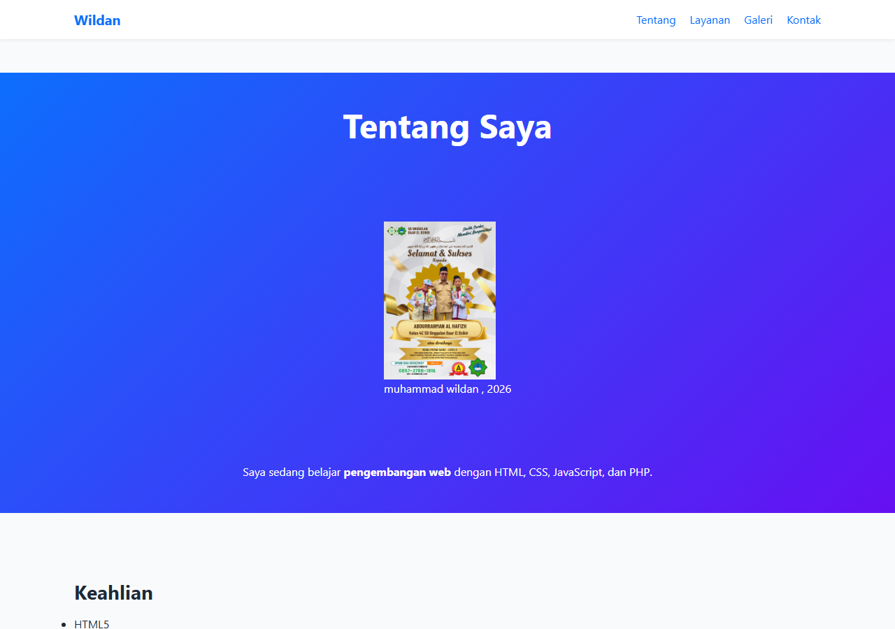
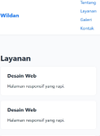
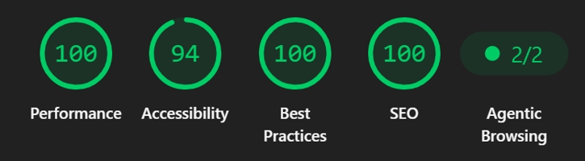

# Proyek 1: Landing Page Profil

Landing page profil pribadi yang menampilkan informasi, keahlian, layanan, dan
galeri. Tampilannya menggunakan nuansa biru dan ungu dengan tata letak
responsif untuk desktop maupun ponsel.

## Demo

Buka [halaman demo](./profil.html) di browser.

## Fitur

- Navigasi ke bagian Tentang, Layanan, Galeri, dan Kontak.
- Bagian profil dan daftar keahlian.
- Kartu layanan dan galeri foto.
- Tabel jadwal kegiatan.
- Formulir kontak.
- Tata letak responsif untuk desktop dan ponsel.

## Teknologi

- HTML5
- CSS3

## Tangkapan Layar

### Desktop

### Ponsel

### tautan GitHub Pages 
https://muhsantri26.github.io/portofolio-junior-web/hari-03-css/profil.html

### nilai 
