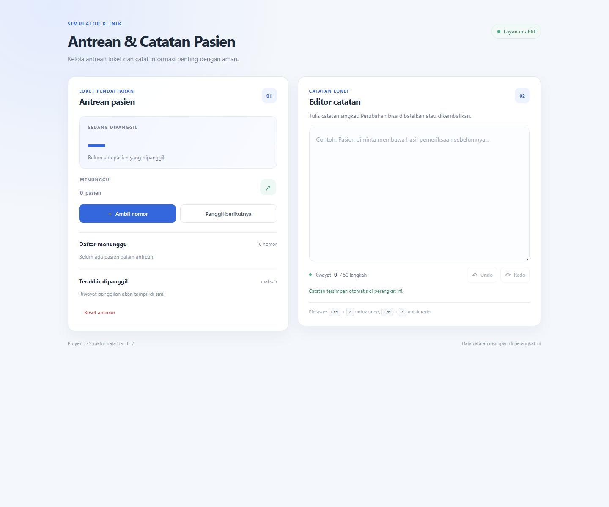

# Proyek 3 - Simulator Antrean dan Catatan Klinik

Aplikasi sederhana untuk mengelola nomor antrean loket dan menulis catatan dengan fitur undo/redo. Proyek ini menggunakan struktur data dari materi Hari 6-7.

## Cara menjalankan

1. Simpan folder proyek di dalam `htdocs` XAMPP.
2. Jalankan Apache dari XAMPP.
3. Buka `http://localhost/portofolio-junior-web/hari-07-SD2/proyek-3-antrian/` di browser.

JavaScript menggunakan ES modules, jadi jalankan lewat server lokal (misalnya XAMPP atau ekstensi Live Server), bukan dengan membuka `index.html` sebagai file langsung.

## Fitur

- **Ambil nomor:** membuat nomor berurutan, misalnya `A001`, `A002`, dan seterusnya.
- **Panggil berikutnya:** memanggil pasien sesuai urutan FIFO. Jika antrean kosong, aplikasi menampilkan pesan.
- **Daftar menunggu:** menampilkan semua nomor dan jumlah pasien yang masih menunggu.
- **Riwayat panggilan:** menyimpan lima nomor terakhir yang dipanggil.
- **Reset antrean:** mengosongkan antrean, riwayat panggilan, dan mengembalikan nomor ke awal.
- **Editor catatan:** mendukung Undo/Redo, pintasan `Ctrl+Z` dan `Ctrl+Y`, serta maksimal 50 langkah Undo.
- **Simpan otomatis:** catatan terakhir disimpan di `localStorage` browser pada perangkat yang sama.

## Struktur data dan alasan pemilihan

| Fitur                   | Struktur data                             | Alasan                                                                                                                                                                                                           |
| ----------------------- | ----------------------------------------- | ---------------------------------------------------------------------------------------------------------------------------------------------------------------------------------------------------------------- |
| Antrean pasien          | `LinkedQueue`, dibangun dari `LinkedList` | Antrean memakai urutan FIFO: pasien yang lebih dulu mengambil nomor dipanggil lebih dulu. Tambah di belakang dan hapus dari depan dapat dilakukan dalam O(1), tanpa menggeser seluruh elemen seperti pada array. |
| Undo dan Redo           | Dua `Stack`                               | Riwayat perubahan mengikuti prinsip LIFO: perubahan terbaru dibatalkan lebih dulu. Undo memindahkan keadaan ke stack Redo; perubahan baru menghapus riwayat Redo yang sudah tidak berlaku.                       |
| Lima panggilan terakhir | Array kecil                               | Hanya lima nomor terbaru yang perlu ditampilkan. Array mudah dipotong menjadi lima data dan tidak memerlukan struktur tambahan.                                                                                  |

Detail internal `Stack`, `Queue`, `LinkedList`, dan `LinkedQueue` disembunyikan menggunakan private field. File `js/structures.js` hanya berisi struktur data dan tidak mengakses DOM.

## Tangkapan layar



## Berkas proyek

```text
index.html
css/
  style.css
js/
  structures.js
  antrian.js
  riwayat.js
  app.js
```
