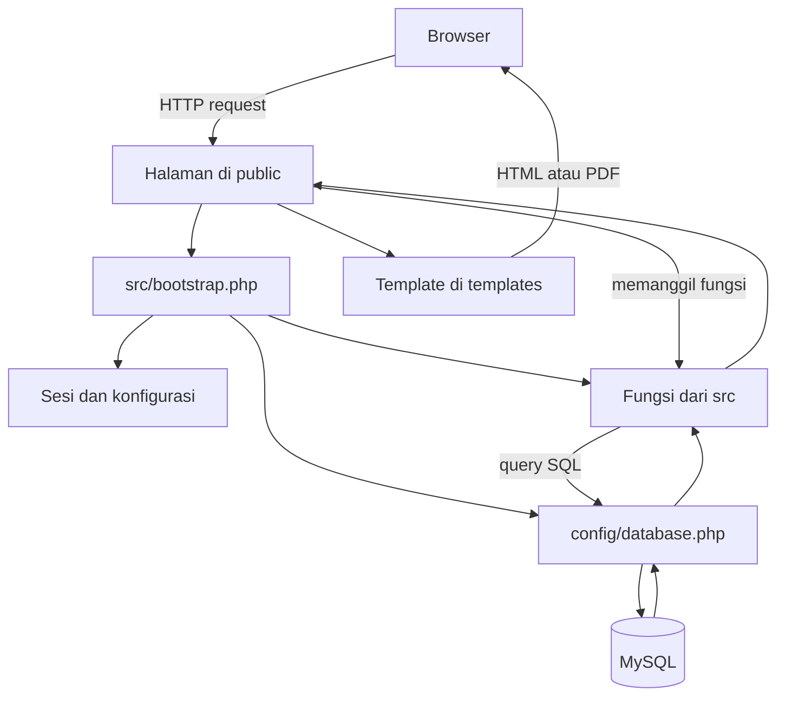
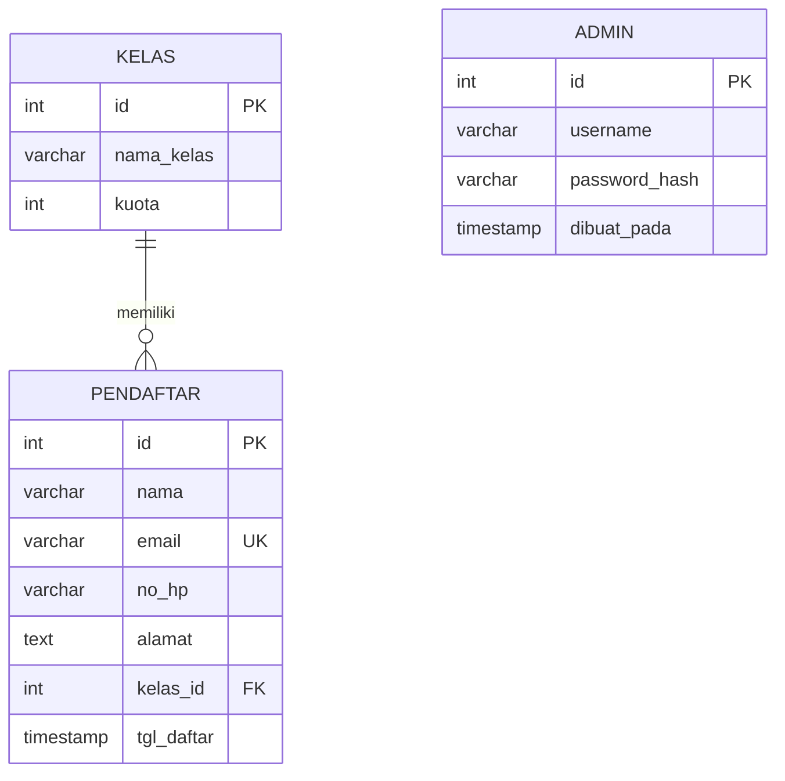

# Arsitektur Proyek Pendaftaran Pelatihan

Dokumen ini menjelaskan susunan folder, alur request, dan hubungan tabel database pada proyek capstone pendaftaran. ERD mengacu pada skema Hari 9 di [`database/skema.sql`](../../../hari-09-sql/proyek-5-capstone-pendaftaran/database/skema.sql); skema yang digunakan di proyek Hari 12 juga tersedia di [`database/skema.sql`](../database/skema.sql).

## 1. Struktur folder

```text
proyek-5-capstone-pendaftaran/
├── config/                 # Pengaturan aplikasi dan koneksi database
├── database/               # Skema SQL dan skrip database
├── docs/                   # Dokumentasi, gambar, dan dokumentasi API
│   ├── modul/               # Dokumentasi modul autentikasi dan pendaftar
│   ├── arsitektur.md        # Dokumen ini
│   ├── peta-modul.md        # Daftar berkas dan fungsi utama
│   └── ...
├── public/                 # Halaman yang dapat diakses melalui browser
│   └── assets/js/           # JavaScript sisi browser
├── src/                    # Fungsi inti aplikasi
├── templates/              # Bagian tampilan yang digunakan ulang
├── vendor/                 # Library PHP dari Composer, termasuk Dompdf
├── composer.json           # Daftar dependensi PHP
└── README.md               # Petunjuk proyek
```

### Tugas folder utama

| Folder | Tugas |
|---|---|
| `config/` | Menyimpan pengaturan aplikasi dan membuat koneksi ke MySQL. |
| `database/` | Menyimpan skema tabel dan skrip untuk menyiapkan database. |
| `public/` | Menangani halaman dan aksi untuk pengunjung serta admin. Folder ini menjadi titik masuk request dari browser. |
| `src/` | Menyiapkan aplikasi dan menyediakan fungsi autentikasi, bantuan, serta pengelolaan pendaftar. |
| `templates/` | Menyimpan kerangka halaman dan tampilan bukti pendaftaran. |
| `docs/` | Menyimpan panduan proyek, dokumentasi modul, dan gambar. |
| `vendor/` | Menyimpan library pihak ketiga yang dipasang melalui Composer; jangan mengubah isinya secara manual. |

## 2. Alur request

Setiap halaman PHP di `public/` memuat `src/bootstrap.php`. Bootstrap memulai sesi, membaca konfigurasi, lalu memuat koneksi database dan fungsi dari `src/`. Setelah proses halaman selesai, halaman biasanya memakai template dari `templates/` untuk menampilkan hasilnya.



### Contoh alur pendaftaran

1. Pengunjung membuka `public/tambah.php`; halaman mengambil daftar kelas dan menampilkan formulir.
2. Saat formulir dikirim, halaman memeriksa token CSRF dan memvalidasi data pendaftar.
3. Jika data tidak valid, halaman menampilkan formulir lagi dengan pesan kesalahan.
4. Jika data valid, `daftarkanDenganKuota()` memulai transaksi, mengunci kelas yang dipilih, dan memeriksa jumlah pendaftar.
5. Jika kuota penuh, transaksi dibatalkan dan halaman menampilkan pesan kuota penuh. Jika masih tersedia, data disimpan dan transaksi diselesaikan.
6. Setelah berhasil, pengunjung diarahkan kembali ke halaman depan dengan pesan konfirmasi.

### Contoh alur login admin

1. Admin membuka `public/login.php` dan mengirim username serta kata sandi melalui formulir.
2. Halaman memeriksa token CSRF dan batas percobaan login, lalu memanggil `prosesLogin()`.
3. `prosesLogin()` mencari admin di database dan mencocokkan kata sandi dengan `password_verify()`.
4. Jika cocok, ID sesi diperbarui, ID admin disimpan ke sesi, dan admin diarahkan ke `public/admin.php`.
5. Halaman admin memanggil `wajibLogin()` untuk memastikan sesi admin tersedia sebelum menampilkan data.

## 3. ERD database

ERD berikut mengikuti struktur database Hari 9. Satu kelas dapat memiliki banyak pendaftar, sedangkan setiap pendaftar harus terhubung ke satu kelas. Tabel admin menyimpan akun admin dan tidak memiliki hubungan langsung dengan tabel pendaftar.



### Keterangan hubungan

| Hubungan | Arti |
|---|---|
| `KELAS` ke `PENDAFTAR` | Satu kelas dapat memiliki nol atau banyak pendaftar. Setiap pendaftar harus memilih satu kelas melalui `kelas_id`. |
| `PENDAFTAR.email` | Email harus unik sehingga tidak bisa digunakan oleh lebih dari satu pendaftar. |
| `ADMIN` | Menyimpan akun admin secara terpisah. `password_hash` menyimpan hasil hash kata sandi, bukan kata sandi aslinya. |

Foreign key `pendaftar.kelas_id` merujuk ke `kelas.id`. Database menolak penghapusan kelas yang masih dipakai pendaftar (`ON DELETE RESTRICT`) dan meneruskan perubahan ID kelas ke data pendaftar (`ON UPDATE CASCADE`).